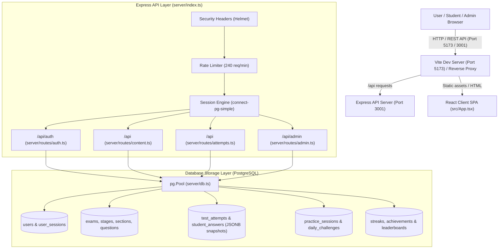
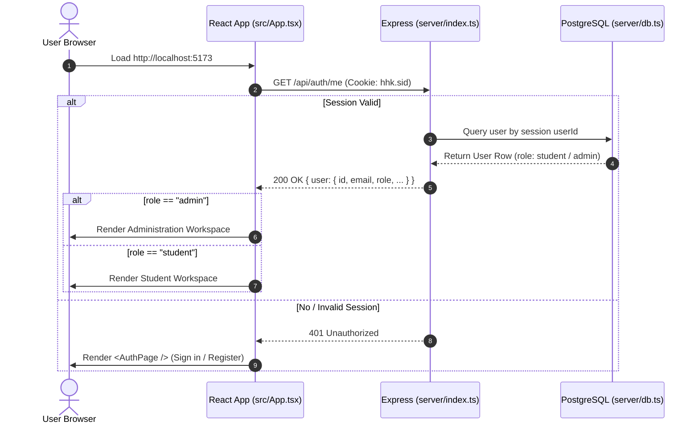
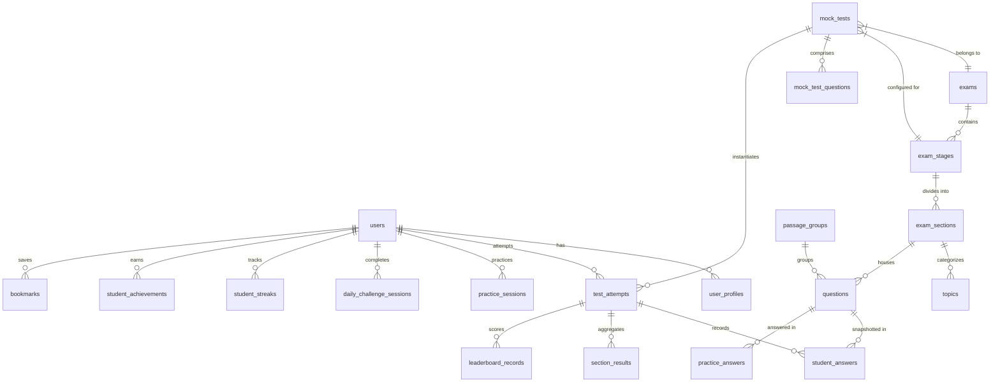
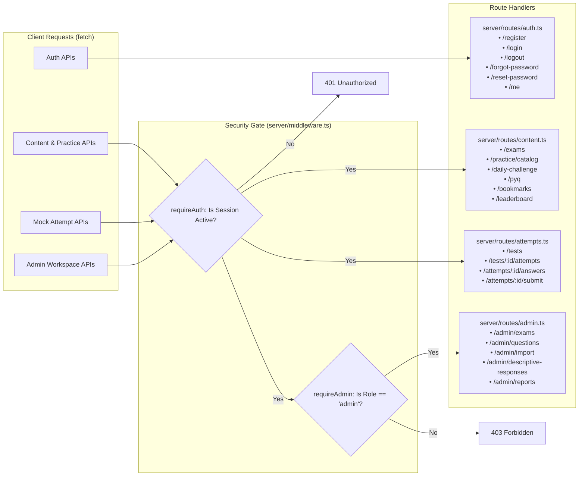
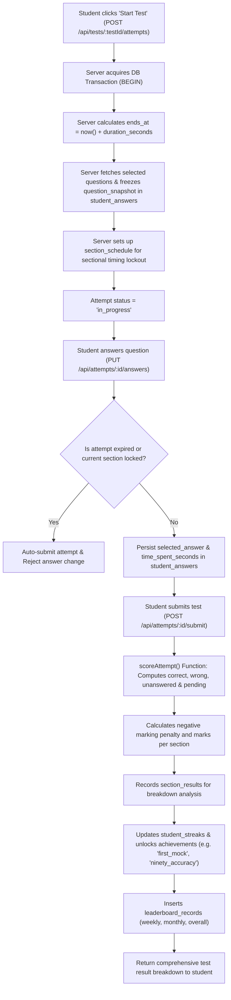

# HHK Banking Exam Preparation Platform — Comprehensive Architecture & Flow Map

This document details the complete end-to-end architecture, lifecycle, data persistence model, and API flows of the **HHK Banking Exam Preparation Platform**.

---

## 1. High-Level System Architecture

The project is structured as a full-stack TypeScript application composed of:

1. **Frontend (Vite + React 19 + TypeScript)**: Single Page Application (SPA) serving both the Student Workspace and Admin Dashboard.
2. **Backend API (Express 5 + TypeScript via tsx)**: RESTful API server enforcing session authentication, role-based authorization, rate limiting, and business logic.
3. **Database (PostgreSQL 17/18)**: Relational database with 31 tables, ACID transactions, and JSONB snapshots for immutable test attempt audits.



---

## 2. Where It Begins: Application Lifecycle & Startup

### 2.1 Backend Server Startup (`server/index.ts`)

1. **Environment Initialization**: Loads `.env` via `dotenv/config`. Verifies `SESSION_SECRET` length (≥ 32 chars) and `DATABASE_URL`.
2. **Database Pooling**: Initializes `pg.Pool` with connection pool limits (default 10) and SSL configuration ([server/db.ts](file:///c:/Users/haris/Desktop/React%20JS%20Project/HHK/HHK/server/db.ts)).
3. **Session Store**: `connect-pg-simple` initializes the `user_sessions` PostgreSQL table and prunes expired sessions every 15 minutes.
4. **Middleware Pipeline**:
   - `helmet()`: Applies HTTP security headers.
   - `express.json({ limit: '8mb' })`: Parses incoming request bodies (enabling Excel/CSV question imports).
   - `session(...)`: Manages HTTP-only, secure, lax cookies (`hhk.sid`).
   - `rateLimit`: Shields all `/api` endpoints.
5. **Route Registration**: Mounts `authRouter`, `contentRouter`, `attemptRouter`, and `adminRouter`.
6. **Listener**: Binds to `process.env.PORT` (default `3001`).

### 2.2 Frontend Client Startup (`src/main.tsx` & `src/App.tsx`)

1. **Entry Point**: `index.html` loads `src/main.tsx`, which mounts `React.StrictMode` and `<App />`.
2. **Session Verification**: `src/App.tsx` immediately issues a `GET /api/auth/me` with `credentials: "include"`.
3. **Route Determination**:
   - **If unauthenticated (`401` or null user)**: Displays `<AuthPage />` (Login, Register, Forgot Password, Reset Password).
   - **If authenticated as `student`**: Renders `STUDENT WORKSPACE` navigation with 11 views (Overview, Daily challenge, Practice, Bookmarks, Mock tests, Performance, PYQ, Current affairs, Leaderboard, Achievements, Profile).
   - **If authenticated as `admin`**: Renders `ADMINISTRATION` workspace with 8 views (Admin dashboard, Exam setup, Question bank, Mock tests, Students, Current affairs, Reports, Settings).



---

## 3. Data Storage & Schema Relationships

The PostgreSQL database is organized into 6 functional clusters spanning 31 tables:



### Key Data Architecture Principles:

1. **Immutable Question Snapshots (`question_snapshot` JSONB)**:
   When an attempt or daily challenge is created, the question text, options, correct answer, explanation, marks, and negative marks are snapshotted into `student_answers.question_snapshot`. Any subsequent modifications by admins to live questions **never alter past student test results**.
2. **Postgres-Backed Sessions (`user_sessions`)**:
   Session states are persisted in PostgreSQL rather than in-memory, allowing the server to be restarted without logging users out.
3. **Audit Log Trail (`audit_logs`)**:
   Every admin action (creating exams, publishing questions, grading descriptive submissions, bulk CSV imports) is permanently logged with the actor's ID and timestamp.

---

## 4. API Endpoints & Request Flow



---

## 5. Core Business Flow: Mock Test Lifecycle

The mock testing engine enforces server-side timekeeping, sectional constraints, and automated scoring:



---

## 6. Descriptive Evaluation & Manual Grading Flow

For banking exams with written essays/letters (e.g. SBI PO / IBPS PO Descriptive Paper):

1. **Submission**: The student types their response. The system marks `question_type = 'descriptive'` and `manual_score = NULL` (`pending_review_count++`).
2. **Admin Queue**: The administrator views `/admin/descriptive-responses`.
3. **Rubric Review**: The admin inspects the question rubric, word count, and student response.
4. **Grading (`POST /api/admin/descriptive-responses/:id/grade`)**:
   - Updates `student_answers.manual_score` and `grader_comment`.
   - Automatically recalculates `test_attempts.score` and updates the student's leaderboard ranking and notification history.

---

## 7. File Map & Directory Blueprint

```text
HHK/
├── server/                           # Backend Node.js / Express API
│   ├── index.ts                      # Server bootstrap, middleware, router mounts
│   ├── db.ts                         # PostgreSQL connection pool configuration
│   ├── middleware.ts                 # Auth guards (requireAuth, requireAdmin, Zod validator)
│   ├── migrate.ts                    # Migration runner for server/migrations/*.sql
│   ├── schemas.ts                    # Zod validation schemas
│   ├── seed-admin.ts                 # CLI seed script for root administrator
│   ├── routes/
│   │   ├── auth.ts                   # Registration, login, logout, password reset
│   │   ├── content.ts                # Exams, practice sets, daily challenge, PYQ, streaks
│   │   ├── attempts.ts               # Test attempt creation, answering, timing, scoring
│   │   └── admin.ts                  # Question authoring, bulk Excel import, manual grading
│   └── migrations/                   # 10 incremental SQL schema files
│
├── src/                              # Frontend React 19 Application
│   ├── main.tsx                      # DOM entry point mounting <App />
│   ├── App.tsx                       # Root container, auth state check, workspace router
│   ├── AuthPage.tsx                  # Sign in / Register forms with 6-char limit & eye view
│   ├── StudentWorkspace.tsx          # 11 Student modules (test runner, practice, charts)
│   ├── AdminPanel.tsx                # Exam setup, question creator, CSV importer, test editor
│   ├── AdminOverview.tsx             # Admin analytics, student monitoring, audit activity
│   └── styles.css                    # Responsive stylesheet and design system
│
├── .env                              # Environment variables (Database URL, Admin credentials)
├── ARCHITECTURE.md                   # Complete architectural flow map and system analysis
├── compose.yaml                      # Docker Compose specification for PostgreSQL
├── package.json                      # Scripts & dependencies
└── README.md                         # Project setup, execution guide, and command reference
```
